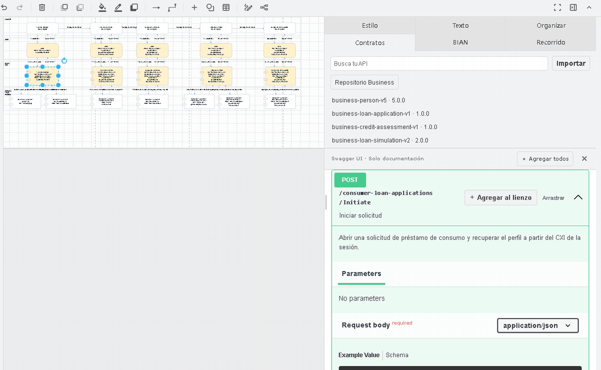

# Agenticos · Diseño de APIs de canal

Diseña un flujo desde la historia del desarrollador. El agente entrevista por rondas, contrasta operaciones en BIAN y en un catálogo Git de contratos, y genera una spec, un OpenAPI por servicio UX y un `.drawio` animado. La plantilla baja por Frontend, APIM, MS en AKS y Business / Capa Producto. Las etapas avanzan de izquierda a derecha.

## Cómo usar las skills en Codex

Abre un chat en el proyecto Agenticos. Puedes mencionar la skill con `$` como en estos ejemplos o enviar solo la descripción del requerimiento para que Codex seleccione el flujo según `AGENTS.md`.

### `$canal-diseno` · Diseñar un flujo desde cero

> $canal-diseno Quiero diseñar un flujo de préstamo de consumo. Comienza con el inicio de la solicitud, continúa con evaluación crediticia, simulación y confirmación de datos, y termina con el desembolso.

1. Entrevista por rondas para aclarar etapas, datos, responsables y resultados.
2. Consulta el catálogo Business y BIAN para identificar operaciones reutilizables. Registra las referencias confirmadas y los pendientes.
3. Propone uno o varios servicios UX según sus responsabilidades y guarda las decisiones y escenarios en la spec.
4. Genera un OpenAPI por servicio UX y abre el diagrama animado en Draw.io.

[Guía de diseño de canal](docs/channel-design.md)

### `$microservicio-diseno` · Diseñar un cambio en un servicio existente

> $microservicio-diseno Quiero agregar `DELETE /accounts/{id}` al CRUD de cuentas de Hackathon.

1. Revisa el contrato vigente y las dependencias relevantes del servicio en modo lectura.
2. Pregunta por el resultado de un borrado repetido, la validación del ID, el orden entre BD y Redis y la publicación del evento.
3. Registra acuerdos, pendientes y escenarios en la spec. Genera una copia del OpenAPI con el cambio propuesto y conserva las demás operaciones.
4. Abre el diagrama en Draw.io con un recorrido por escenario acordado, como cuenta eliminada, cuenta ausente o ID inválido.

[Guía de cambios en microservicios](docs/service-change.md)

## Demo de préstamos



El GIF muestra el diagrama generado y un tramo del escenario **Solicitud aprobada**. [Diagrama de decisiones del agente](docs/channel-design.md#flujo-y-decisiones-del-agente) · [Prompt y consultas de la demo](docs/channel-design.md#ejemplo-de-entrevista)

Con Node.js 24.18.x, npm y Git, abre una terminal en el repositorio:

```powershell
npm ci
npm run channel:editor
```

En otra terminal:

```powershell
npm run channel:demo -- --open
```

El fork presenta **Contratos**, **BIAN** y **Recorrido** en el panel derecho. Desde **Contratos → Repositorio Business** puedes buscar los [20 contratos ficticios](https://github.com/DiegoAlosilla/business-contracts-demo). La primera ejecución prepara el editor y clona el catálogo.

## Editor y pruebas

La [guía de estructura del proyecto](docs/project-structure.md) explica las carpetas principales, los módulos de `src/` y cómo pasan los datos del agente al editor.

Agenticos reutiliza la extensión Draw.io de [Backend Java Hackathon](https://github.com/DiegoAlosilla/backend-java-hackathon/tree/3fc4a590a5344f777ea39e96229e4d2be94290c1). El arranque verifica y prepara la distribución de Draw.io. Consulta los [avisos de terceros](editor/THIRD_PARTY_NOTICES.md) y la [guía del editor](docs/editor.md).

Para ejecutar las pruebas del fork, instala el navegador con `npm --prefix editor run test:browser-install` y ejecuta `npm test`. La prueba de integración del catálogo requiere `CHANNEL_CONTRACTS_DIR` apuntando al clon Business bajo `runs/business-contracts-demo`.
