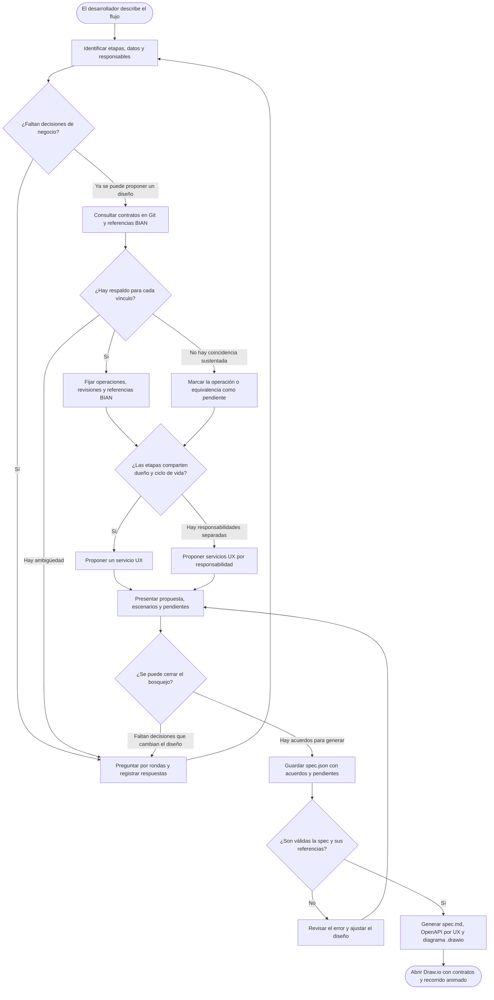

# Diseño de APIs de canal desde una conversación

Abre este repositorio en Codex y describe el flujo que quieres diseñar. En Copilot, selecciona `channel-design` antes de enviar la descripción. [Protocolo del agente](../agents/channel-design-protocol.md)

Los flujos nuevos utilizan [cuatro roles y un coordinador versionado](orchestration.md): Discovery, Architecture, Contract y Reviewer. El CLI de canal descrito aquí mantiene las consultas, la spec y el generador; `orchestrate submit --role contract` integra esa generación con trazabilidad, revisión y límites de iteración. `channel build` y `channel:demo` siguen disponibles como herramientas directas sin revisión orquestada.

## Flujo y decisiones del agente



Un bosquejo puede incluir una dependencia sin resolver si queda identificada como pendiente. Si faltan datos que cambian el diseño, el agente vuelve a la entrevista. Por ejemplo, quién decide el rechazo crediticio afecta tanto el contrato UX como el punto donde termina ese recorrido.

## Ejemplo de entrevista

Prompt para reproducir el requerimiento con el agente:

> Quiero diseñar un flujo de préstamo de consumo. Comienza con el inicio de la solicitud, continúa con evaluación crediticia, simulación y confirmación de datos, y termina con el desembolso.

Al recibir la historia, el agente inicia la entrevista por rondas, consulta el catálogo Business y BIAN, y usa las respuestas para generar los entregables y abrir Draw.io. La tabla muestra las decisiones ficticias precargadas que `channel:demo` usa para reproducir el ejemplo.

| Paso | Qué revisa el agente | Decisión de la demo |
| --- | --- | --- |
| Iniciar solicitud | ¿Qué identifica al cliente y qué conecta las etapas? | La sesión autenticada aporta el CXI. `business-person-v5` recupera el perfil y `business-loan-application-v1` devuelve el identificador de solicitud. |
| Evaluar crédito | ¿Quién decide y qué pasa si rechaza? | `business-credit-assessment-v1` evalúa al solicitante. El rechazo devuelve `422` desde UX y termina el recorrido. |
| Simular | ¿Qué devuelve la simulación y cómo se elige? | `business-loan-simulation-v2` calcula cuota, tasa y plazo. El cliente puede simular varias veces y confirma la simulación elegida. |
| Confirmar datos | ¿Qué se comprueba antes de aceptar? | `business-account-ownership-v1` verifica la cuenta de abono y `business-loan-confirmation-v1` registra la aceptación. |
| Ejecutar desembolso | ¿Cómo se repite la operación y qué pasa si el resultado es incierto? | UX propaga `Idempotency-Key` a `business-loan-disbursement-v2`. La conciliación queda pendiente. |

### Consultas que sustentan el diseño

Estas consultas se ejecutaron contra el catálogo ficticio y la versión de BIAN incluida en Agenticos:

```powershell
npm run channel -- search --query 'riesgo crediticio'
npm run channel -- operation --file contracts/business-credit-assessment-v1.openapi.json --method POST --path /credit-assessments
npm run channel -- bian --query 'Customer Offer' --action Initiate
```

La primera encuentra `business-credit-assessment-v1`. La segunda permite revisar el contrato `POST /credit-assessments`, que recibe `applicationId`, `cxi` y `requestedAmount`. La tercera devuelve `CustomerOffer` y su operación BIAN `POST /CustomerOffer/Initiate`, usada como referencia para el inicio. Las equivalencias BIAN de evaluación y simulación quedan pendientes en el ejemplo.

### De las respuestas al diagrama

1. El agente agrupa las cinco operaciones en un solo UX porque comparten dueño y ciclo de vida. Registra acuerdos, operaciones reutilizadas, referencias BIAN y pendientes en `spec.json`.
2. El generador valida los contratos vinculados y produce `spec.md`, el OpenAPI de UX y `channel.drawio`. La demo incluye una página de aprobación y otra de rechazo.
3. En el fork, **Contratos** muestra Swagger, **BIAN** abre la referencia de la figura y **Recorrido** reproduce las llamadas. [GIF capturado en Draw.io](media/demo-prestamos-drawio.gif)

## Demo rápida

Requiere Node.js 24.18.x, npm 11.16.x y Git. Tras clonar el proyecto, ejecuta en una terminal:

```powershell
npm ci
npm run channel:editor
```

Esto clona el [catálogo público de 20 contratos Business ficticios](https://github.com/DiegoAlosilla/business-contracts-demo) en `runs/business-contracts-demo` si aún no existe, prepara el fork y abre el servicio en `127.0.0.1:8080`. Para una demo con otro catálogo, inicia `npm run channel:editor -- --repo <clon-git>`. Para actualizar un clon, usa `git -C <clon-git> pull --ff-only`. El buscador lee el nuevo `HEAD` en la siguiente consulta.

En otra terminal:

```powershell
npm run channel:demo -- --open
```

El CLI imprime el directorio bajo `runs/channel` con `spec.json`, `spec.md`, `contracts/*.openapi.yaml` y `channel.drawio`. La demo propone un UX con cinco operaciones y siete dependencias Business, con páginas de aprobación y rechazo crediticio. Mantiene abiertas las equivalencias BIAN de evaluación y simulación, y la decisión de conciliación del desembolso.

- En el diagrama, selecciona la primera figura UX y pulsa **Recorrido → Reproducir**. Las capas forman franjas de arriba abajo: Frontend → APIM → MS en AKS → Business / Capa Producto. Las etapas avanzan de izquierda a derecha. Los consumos de cada etapa se ordenan dentro de la franja inferior y las respuestas regresan por APIM.
- En **BIAN**, consulta la referencia de la figura seleccionada o busca operaciones en el catálogo local. En **Contratos**, consulta Swagger y la procedencia de los consumos vinculados.
- Amarillo indica implementación nueva y blanco indica un componente existente. Un borde discontinuo y la palabra **Pendiente** identifican consumos por resolver. En la demo, el Frontend y las APIs Business se reutilizan. Las rutas APIM y el UX son nuevos.
- Selecciona un consumo Business para ver en Swagger el método, la ruta, el esquema y la revisión empleada.
- En **Contratos → Repositorio Business**, busca `desembolso`, `lead`, `CXI` u otro término. Abrir un resultado trae esa revisión al documento y expande la operación seleccionada. Puedes añadir la figura al lienzo desde Swagger.
- Los contratos de la demo contienen solo definiciones OpenAPI. El reproductor recorre las interacciones diseñadas y el buscador lee Git. Ambos funcionan sin levantar los microservicios de ejemplo.

## Herramientas de la entrevista

Con el núcleo del editor preparado, usa el CLI desde la raíz:

```powershell
npm run channel -- search --query "riesgo crediticio"
npm run channel -- bian --query "iniciar oferta prestamo consumo" --action Initiate
npm run channel -- operation --file contracts/business-person-v5.openapi.json --method GET --path '/people/{cxi}'
npm run channel -- build --input runs/diseno/prestamos.json --open
```

`search` devuelve el commit y los contratos candidatos. `operation` muestra parámetros, cuerpo, respuestas y seguridad efectiva para que el agente contraste la operación. Usa `--ref <commit>` al consultar una revisión y `--repo <clon-git>` o `CHANNEL_CONTRACTS_DIR` para seleccionar otro catálogo. Los contratos deben ser OpenAPI 3.1, OpenAPI 3.0 o Swagger 2 autocontenidos. Los archivos incompatibles se reportan como omitidos en la búsqueda. `--open` usa el fork local y acepta `--editor-url` para otro puerto.

## Formato de la spec

Usa el `spec.json` generado por la demo como ejemplo editable.

| Campo | Contenido |
|---|---|
| `version`, `project`, `frontend`, `goal` | Versión `1`, título, canal y propósito. |
| `decisions`, `pending` | Listas de acuerdos y decisiones abiertas. |
| `catalogCommit` | Commit devuelto por el catálogo. Obligatorio al vincular consumos. |
| `services[]` | `id`, `title`, `responsibility`. Acepta `components` y `security` de OpenAPI. Se genera un OpenAPI por servicio UX. |
| `stages[]` | `id`, `title`, `purpose`, `service`, `rules`, `operation` (`method`, `path`, `parameters`, `requestBody`, `responses`, `security`) y `success` (código HTTP 2xx declarado). |
| `stages[].bian` | `domain`, `method`, `path` de una operación BIAN consultada. Si se omite, el generador registra la equivalencia como pendiente. Una ruta UX con referencia confirmada termina con la acción semántica de esa referencia. |
| `stages[].calls[]` | Orden de consumos de una etapa. Cada uno declara `layer` (`Business` o `Producto`) y `purpose`. Usa `contract` con `file`, `method`, `path`, `sha256` y un `outcome` esperado, o usa `pending` con la decisión abierta. `mapping` registra pares `from` y `to` revisados durante la entrevista. |
| `scenarios[]` | Páginas opcionales con `id`, `title` y `steps[]`. Cada paso referencia `stage` y admite `response`, `callCount` para recorrer solo las primeras llamadas, y `callOutcomes` para describir respuestas alternativas. Sin escenarios, se recorren todas las etapas en orden. |

Los campos opcionales `services[].status`, `stages[].frontendStatus`, `stages[].apimStatus` y `stages[].calls[].status` (para consumos pendientes) aceptan `new` o `existing`. Por defecto, el generador dibuja UX y APIM como nuevos, y Frontend y contratos Business vinculados como existentes. Una dependencia pendiente de clasificación queda sin relleno, con borde discontinuo y la etiqueta **Pendiente**.

La spec es la fuente para regenerar. Una regeneración crea otra propuesta bajo `--out` y conserva los archivos previamente revisados. El `.drawio` guarda las revisiones de los contratos consultados para que sus figuras puedan revisarse en otro perfil.

## Guía con Qwen local en Windows

La configuración de demo usa **Qwen3.5-4B Q4_K_M** y `llama-server`. El peso ocupa unos 2.74 GB y es más manejable para este equipo que Qwen3.6-27B. La preparación verifica las huellas del modelo y del ejecutable y guarda los archivos en `runs/channel-model`. Inicia el servidor en una terminal:

```powershell
pwsh -File scripts/channel-model.ps1 -Prepare
pwsh -File scripts/channel-model.ps1
```

El servidor escucha en `127.0.0.1:8091` y usa una clave local. El agente puede enviar un JSON con `historia`, `acordado` y `pendiente` con `npm run channel -- guide --input <contexto.json>`. Devuelve hasta cuatro preguntas. El CLI acepta otro servidor local compatible con `CHANNEL_GUIDE_PORT`, `CHANNEL_GUIDE_MODEL` y, si aplica, `CHANNEL_GUIDE_KEY`. El chat sigue disponible cuando el modelo está apagado. [Modelo original](https://huggingface.co/Qwen/Qwen3.5-4B) · [GGUF fijado](https://huggingface.co/unsloth/Qwen3.5-4B-GGUF/tree/e87f176479d0855a907a41277aca2f8ee7a09523) · [Servidor](https://github.com/ggml-org/llama.cpp/tree/b12360/tools/server)
